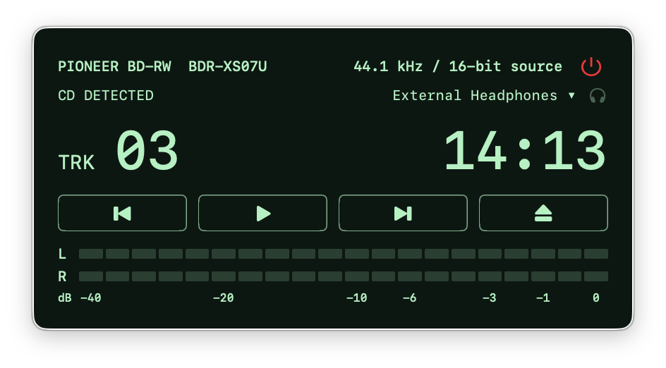

<p align="center">
  
</p>

# CD Player for macOS

A minimal native macOS audio CD player. It reads a CD from an optical drive
and sends its 16-bit, 44.1 kHz PCM to a selected wired output or macOS's
System Default output. The enabled-by-default `Playback > Decode HDCD`
preference decodes only HDCD discs whose packets enable Peak Extend or gain
adjustment, and only when the physical output carries at least 20 bits.
Ordinary CDs and HDCD discs without active decoding features remain
bit-perfect. It behaves like a stand-alone hardware CD player: a few buttons,
a track and time display, the slowest read speed the drive accepts, and error
concealment instead of noisy re-reads.



*Ready to play a three-track CD, with audio levels shown. The meters stay dark
while stopped.*

**Status:** [version 1.3.3 is released](https://github.com/ylau674/CD-player/releases/tag/v1.3.3).
M6.1–M6.5, M8 and M9 are complete and hardware-checked on one
Mac with a Pioneer BDR-XS07U drive. Tested outputs include the built-in
speakers and wired headphones, beyerdynamic PRO X, Sony WALKMAN USB DAC,
Pioneer N-50 over USB, Samsung HDMI, WH-1000XM3 Bluetooth and AirPlay to
another Mac. DisplayPort and Thunderbolt playback have not been tested.
See the [changelog](CHANGELOG.md), [audio-output validation record](docs/AUDIO_OUTPUT_ROADMAP.md),
[audio-level validation record](docs/AUDIO_LEVELS_ROADMAP.md),
[HDCD validation record](docs/HDCD_ROADMAP.md)
and [known limitations](#known-limitations).

Version 1.3.3 is the first public release, under the Apache License 2.0. The
About window now lists the licence and the libhdcd credits. The bundle
identifier changed to `io.github.ylau674.CDPlayer`, so the chosen output and
the Decode HDCD setting from an earlier version are not carried over, and
macOS asks again for access to removable volumes at the first Play. Playback
is unchanged.

Version 1.3.2 lowers memory and CPU use and fixes `OUTPUT LOST` appearing at
every launch. Playback returns its read-ahead memory to macOS when paused or
stopped, and the audio level meters use about 3% of one core when shown. When a
saved output is missing, pressing Play on the fallback now saves it.

Version 1.3.1 lowered the CPU use of the audio level meters: about 4% of one
core with them shown, down from about 12%, with no change to how they look or
measure.

Version 1.3.0 adds HDCD detection and decoding (Playback › Decode HDCD, on by
default). A disc whose HDCD packets switch on Peak Extend or a gain adjustment
is decoded when the output carries at least 20 bits, and the status line and
source text show HDCD and the depth played. Every other disc, including HDCD discs whose
packets switch nothing on, stays bit-perfect. Decoding matched an independent
FFmpeg decode bit for bit on burned test discs; a commercial disc whose
musical peaks use Peak Extend has not been checked yet.

Version 1.2.0 adds optional source-level meters (⌘L), with red peak hold and
measurement only while fully shown and visible, plus working native
minimization (⌘M). Metering does not alter the source audio or output volume.

Version 1.1.0 introduced wired-output selection and best-effort System Default
routing, lost-output handling, volume-key mirroring for directly selected
outputs, and an HDMI/DisplayPort receiver lead-in. Sleep and wake preserve
the paused position and restore the original output format before Play can
resume. Check E passed on the N-50 and Samsung HDMI; Check F confirmed that
PRO X playback leaves microphone and sidetone settings unchanged. Full
hardware results and the remaining limitations are in the
[development guide](docs/DEVELOPMENT.md#m65-hardware-acceptance).

## Features

- **Six controls, one window.**
  - Previous track. Hold it to go back 10 seconds.
  - Play / Pause.
  - Next track. Hold it to go forward 10 seconds.
  - Eject. While playing or paused it becomes Stop.
  - A power icon quits.
  - Drag anywhere on the display to move the borderless window.
- **Simple display.**
  - Track number and elapsed time (`TRK 02` `00:12`). Before Play, after Stop
    and at the end of the disc, it shows the track count and the total time.
  - A status line: `NO DRIVE`, `NO DISC`, `READING`, `CD DETECTED`,
    `CD PLAYING`, `CD PAUSED`, `BUFFERING` or `CD END`. Once playback finds
    HDCD on the disc, these read `HDCD DETECTED`, `HDCD PLAYING`, `HDCD PAUSED`
    and `HDCD END` until the disc is ejected or changed. A disc is a CD until
    then, because its audio is read only after Play.
  - The source format, such as `44.1 kHz / 16-bit source`, or for HDCD the
    depth it plays at: `44.1 kHz / 16-bit HDCD` unchanged, `44.1 kHz / 20-bit
    HDCD` decoded. It follows the audio being played, so on a disc that
    starts decoding only at a later track, it changes when that track starts.
    Also `ERR n` for concealed damaged sectors, and short errors
    shown in red.
- **Audio levels.** View › Show Audio Levels (⌘L) extends the window downward
  to show LED-style left and right sample-peak meters below the transport
  buttons, in the display's style, with the peak hold in the power icon's red.
  They follow the disc source level, not the output volume. They measure only
  once fully shown, so they stay dark while the window extends or shrinks, and
  when playback is stopped or paused. They also stop measuring when the window
  is hidden, minimized, fully occluded, or off-screen, and resume with a fresh
  reading when it becomes visible. The same command shrinks the window back to
  its original size; Reduce Motion uses a fade.
- **Drive detection.**
  - Finds optical drives through IOKit and Disk Arbitration, including empty
    drives and drives plugged in while the app runs.
  - With several drives, a drive icon cycles between them.
  - Works whether or not macOS mounts the disc.
- **Ready to play on insertion.** The track table comes from the drive's
  registry metadata. Audio sectors are read only after you press Play.
- **Slowest read speed.** Before reading, the app requests the drive's minimum
  audio speed (176 kB/s, 1×) and restores the original speed afterwards. The
  drive may ignore the request, so this is best-effort.
- **Bit-perfect source path.**
  - No resampling, EQ, dither or make-up gain. Undecoded Int16 samples map to
    Float32 exactly.
  - **HDCD decoding** is controlled by Playback > Decode HDCD, enabled by
    default and remembered between launches. When enabled, Peak Extend and
    gain adjustment are decoded in the producer thread only when active HDCD
    packets are detected and the physical output carries at least 20 bits.
    Ordinary CDs and non-effectual HDCD sources pass through unchanged. Turn
    it off to keep every disc undecoded; changes apply at the next Play, track
    start or seek.
  - Decoded HDCD plays about 6 dB quieter; the app adds no make-up gain.
    libhdcd by Burt P. (bp0), based on work by Christopher Key, Chris Moeller
    (kode54), Gumboot, Benjamin Steffes, Luca Barbato (lu-zero) and James
    Almer (jamrial), is vendored under its BSD license; see
    [AUTHORS](Packages/CDKit/Sources/HDCD/AUTHORS).
  - The built-in output runs at 44.1 kHz while a CD plays, and its previous
    rate is restored afterwards. A status-line icon shows and switches the
    output rate.
  - The output is shared rather than taken exclusively, so the volume keys
    keep working.
  - Wired outputs use the selected Core Audio device; System Default is an
    opt-in best-effort route to whatever macOS uses, including Bluetooth and
    AirPlay. System Default may be converted by macOS or the wireless link.
  - On HDMI and DisplayPort, playback starts with one second of silence so
    the receiver can lock to the rate before the first CD sample.
  - When a selected output disappears, playback pauses and shows
    `OUTPUT LOST`; it never resumes automatically. The output selector shows
    a fallback, and pressing Play or choosing that fallback saves it, so the
    notice doesn't return at the next launch. The missing output is used
    again only when chosen.
  - A 15-second read-ahead buffer, returned to macOS while paused or stopped.
- **Damaged discs.**
  - Each block is read once, as a hardware player does.
  - C2-flagged samples are interpolated, unreadable sectors are silenced, and
    both are counted on the display.
  - Clean sectors stay bit-exact.
- **Hardening.**
  - Keeps the Mac awake while playing.
  - Pauses before sleep and when the output changes, for example when
    headphones are plugged in or unplugged.
  - Restores the output's original rate and stream formats at the next launch
    after a crash, and after wake if macOS delays restoration during sleep.
  - Recovers cleanly when the drive is unplugged while playing, paused,
    seeking or ejecting.
- **Light.** In Release, playback uses about 2% of one CPU core with the
  meters hidden and about 3% with them shown. Memory measured 39–41 MB while
  playing and 33–38 MB while paused, since Pause returns the read-ahead buffer
  to macOS.

## Requirements

- macOS 14 Sonoma or newer, on Apple silicon or Intel (universal binary).
- An optical drive that can read audio CDs.
- macOS must allow the logged-in user to read the drive's raw device. The app
  does not work around managed removable-media policy.
- To build: Xcode with the macOS SDK (Swift 6 language mode) and
  [XcodeGen](https://github.com/yonaskolb/XcodeGen). No third-party packages
  need installation; the only vendored dependency is the pinned BSD-licensed
  [libhdcd source](Packages/CDKit/Sources/HDCD/LICENSE).

## Build and run

```sh
brew install xcodegen          # once
xcodegen generate              # creates CDPlayer.xcodeproj (not committed)
xcodebuild -project CDPlayer.xcodeproj -scheme CDPlayer \
  -configuration Debug -derivedDataPath build build
open build/Build/Products/Debug/CDPlayer.app
```

Or open the generated `CDPlayer.xcodeproj` in Xcode and run the **CDPlayer**
scheme. The first Play may trigger a macOS prompt to allow access to removable
volumes. Allow it.

Run the offline test suite (no drive or audio hardware needed, makes no sound):

```sh
swift test --package-path Packages/CDKit
```

To set up a new machine and for the full workflow, see the
[development guide](docs/DEVELOPMENT.md).

## Release package

```sh
./Tools/package-release.sh
```

The script builds the universal Release app with the hardened runtime and an
ad-hoc signature. It verifies the build and writes
`build/packages/CDPlayer-<version>-macOS.zip`. Install by dragging
`CDPlayer.app` from the ZIP into `/Applications`.
The current [1.3.3 release ZIP](https://github.com/ylau674/CD-player/releases/download/v1.3.3/CDPlayer-1.3.3-macOS.zip)
is also available on GitHub. Compare its SHA-256 with the digest on the
release page; see [security](SECURITY.md).

The app is **not** Developer ID signed or notarized. If the ZIP reaches
another Mac by download, AirDrop, Messages or e-mail, Gatekeeper blocks the
first launch.

- **macOS 15 or later:** after the blocked attempt, open **System Settings ›
  Privacy & Security**, click **Open Anyway** next to the CD Player message,
  and confirm with your password.
- **macOS 14:** Control-click the app and choose **Open**.

A DMG would not avoid this; only notarization does. See
[testing on another Mac](docs/DEVELOPMENT.md#test-on-another-mac) and
[publishing](docs/PUBLISHING.md).

## Keyboard and menus

| Action | Shortcut |
|---|---|
| Play / Pause | Space |
| Previous / next track | ⌘← / ⌘→ |
| Back / forward 10 seconds | ⌥← / ⌥→ (or hold the button) |
| Stop, or Eject when stopped | ⌘E |
| Demo disc (simulated, test tones) | ⌘O |
| Back to the optical drive | ⇧⌘O |
| Show / hide audio levels | ⌘L |
| Minimize (restore from the Dock) | ⌘M |
| Quit (restores audio settings) | ⌘Q or the red power icon |

**File › Select Optical Drive** and **File › Refresh Optical Drives** are also
available. VoiceOver exposes the 10-second skips as actions and labels the
meters "Audio levels".

## Safety and privacy

- Audio is read only from the raw device (`/dev/rdiskN`), read-only, as the
  logged-in user, and only after Play.
- The app never mounts a disc, asks for administrator rights, uses SCSI
  pass-through or tries another route when macOS refuses access.
- Eject unmounts without force and never force-ejects.
- It changes volume or mute only while a CD plays on a directly selected
  output that is not the macOS default: the default's volume and mute are
  mirrored onto that output so the volume keys reach it. Play first sets the
  default's level to the selected output's, so the output playing never
  jumps; nothing is restored afterwards.
- It has no network access and no telemetry. The only stored data is a
  preferences record of output rates and formats still to be restored after
  a crash or sleep.

## What "bit-perfect" means here

The app reproduces every 16-bit source value exactly and does not resample
44.1 kHz audio. The tests check all 65,536 sample values through the
conversion and the output callback.

What happens after the app hands samples to Core Audio is outside that
guarantee:

- macOS volume.
- The built-in speakers' Apple DSP.
- The driver and the analog stage.

For the cleanest built-in path, use wired headphones or an amplifier on the
headphone jack. Concealed sectors on a damaged disc are an approximation, not a
reconstruction.

## Project layout

```text
App/                    SwiftUI/AppKit app: window, display, transport buttons, menus
  Assets.xcassets/      App icon
Packages/CDKit/         Swift package with all player logic (tested offline)
  Sources/CDAudioCore/  C shim: CD ioctls, Core Audio output, lock-free PCM ring
  Sources/CDKit/        Player model, disc session, read recovery, drive service
  Sources/AudioCheck/   Hardware check tool: output inspection, silent disc pipeline, PCM capture
  Sources/OpticalCheck/ Hardware check tool: drive listing, read check, eject
  Tests/CDKitTests/     Offline Swift Testing suite with fake drives and engines
Tools/
  cdprobe/              Stand-alone read-only disc probe (C)
  check-hdcd-ffmpeg.sh  Temporary-sample libhdcd/FFmpeg comparison
  package-release.sh    Release build, verification and ZIP
docs/                   Architecture, development guide, full development log
project.yml             XcodeGen project specification
```

## Documentation

- [Architecture](docs/ARCHITECTURE.md): modules, data flow, threading and key
  design decisions.
- [Development guide](docs/DEVELOPMENT.md): new-machine setup, build, test,
  hardware checks, conventions and the backlog.
- [Behaviour specification and development log](docs/DEVELOPMENT_LOG.md):
  every agreed behaviour and the verification record for milestones M1–M6.5.
- [Publishing checklist](docs/PUBLISHING.md).
- [Changelog](CHANGELOG.md).
- [Contributing](CONTRIBUTING.md) and [security policy](SECURITY.md).

## Known limitations

- **Tested hardware.** Live validation used one MacBook Pro and a Pioneer
  BDR-XS07U drive. Other drive models and Macs have not been tested. The read
  fallbacks for drives without C2 error pointers or stream-accurate reads are
  covered only by offline tests.
- **Drive speed.** The Pioneer accepts the minimum-speed request but does not
  confirm it.
- **Drive read offset.** The app plays what the drive returns and does not
  correct the drive's read offset (667 frames, 15 ms, on the Pioneer). A track
  started from its beginning, by skipping to it or by Stop then Play, begins
  with the last 15 ms of the track before it. On a burned HDCD test disc,
  whose tracks end abruptly at a high level, that was an audible click at some
  track starts; on an ordinary CD tried, those 15 ms were quiet and ran
  straight into the music, with no click. Continuous play across a track
  boundary is unaffected.
- **Mounted discs.** Playback of a disc that macOS has mounted is tested
  offline only. On Macs that mount audio CDs, set **System Settings › CDs &
  DVDs › When you insert a music CD** to **Ignore**, so that Music does not
  compete for the drive.
- **Output.** DisplayPort and Thunderbolt playback have not been tested.
  Multistream AUHAL output layouts are also unvalidated. System Default may
  convert audio in macOS or the wireless link. HDMI display sleep can silence
  the screen while macOS still reports the output; pause playback first.
- **No metadata.** There are no CD-Text, online track titles, playlists,
  shuffle or repeat.
- **HDCD Peak Extend.** Synthetic offline and CD-RW validation confirm
  high-level peak restoration and bit-exact agreement with FFmpeg, and the
  synthetic CD-RW played audibly in the app. Live listening verification with
  real-program HDCD whose musical peaks are lifted by Peak Extend remains open.
- **Distribution.** The build is ad-hoc signed and not notarized.

## License

CD Player is licensed under the [Apache License, Version 2.0](LICENSE); see
also [NOTICE](NOTICE). The vendored libhdcd decoder in
`Packages/CDKit/Sources/HDCD` keeps its own
[BSD 2-Clause licence](Packages/CDKit/Sources/HDCD/LICENSE), whose notices
the app shows in **CD Player › About CD Player**.
